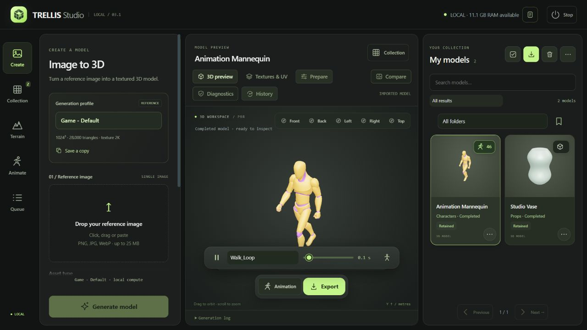
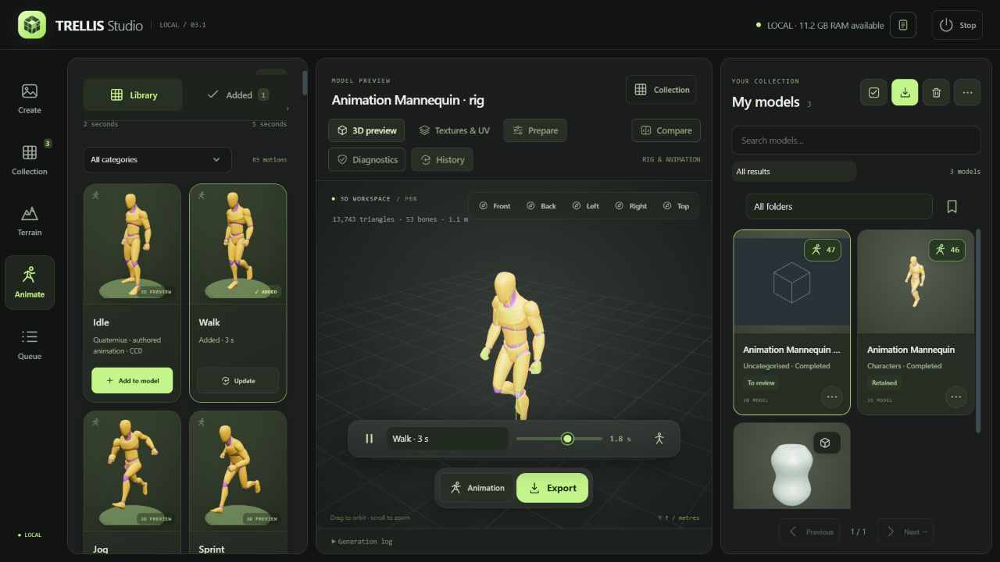

<h1 align="center">TRELLIS Studio</h1>

A local workspace for creating, preparing, rigging and animating 3D assets.

<a href="LICENSE">MIT · Studio code</a> · <a href="INSTALLATION.md">Installation</a> · <a href="docs/API.md">REST API</a> · <a href="docs/MCP.md">MCP</a> · <a href="THIRD_PARTY_NOTICES.md">Credits & licenses</a>

TRELLIS Studio is an independent community application built around **Microsoft TRELLIS.2** and **UniRig**. Generate textured meshes from an image, import existing models, organise a collection, prepare game or printing derivatives, add a skeleton and attach multiple authored animations to the same model. Inspect everything in a browser-based PBR viewer and export for your workflow.

Inference runs on your computer. Models and dependency packages are downloaded during installation; your reference images and generated library stay in your local installation. No paid generation service or API key is required by Studio.

> **First public preview · Windows x64.** The validated generation setup uses an RTX 4070 Ti with 12 GB VRAM and 32 GB RAM. Installation verifies components, but output quality, deformation and target-engine suitability still need visual review. The Studio code is MIT; model and dependency licenses are separate, particularly DINOv3.

*An isolated demonstration collection. No personal library is included in this repository.*

## Get started

1. Check the [prerequisites](INSTALLATION.md#prerequisites): NVIDIA driver, Node.js, Blender and WSL2/Ubuntu for UniRig.
2. [Download the source ZIP](https://github.com/yoslo59/TRELLIS-Studio/archive/refs/heads/main.zip) and extract it to a short local path such as `C:\AI\TRELLIS-Studio`. Git users can clone this repository instead.
3. Double-click **`Install TRELLIS Studio.cmd`**. Read the DINOv3 license and type `ACCEPT` only if you agree. The installer provisions private Python environments, downloads the pinned engines and model files, installs the browser dependencies and verifies the setup.
4. Double-click **`Open TRELLIS.cmd`**. `Ouvrir TRELLIS.cmd` is also supported. Open `http://127.0.0.1:7860` if your browser does not open automatically.

The full model/animation download is approximately **20.6 GiB**, plus the engines and Python packages. Keep **80 GiB free** for download caches, installation and initial work. Downloads are resumable and verified with SHA-256. Re-running the installer preserves existing user data; an unexpected source directory or mismatching completed download produces an error rather than an overwrite.

Read the [detailed installation, repair and troubleshooting guide](INSTALLATION.md). WSL setup, driver installation, a required reboot and third-party license acceptance can require your interaction. The installer does not silently enable Windows features or replace a GPU driver.

## What you can do

| Workspace | Features |
| --- | --- |
| **Create** | Local TRELLIS.2 single-image generation, plus optional Pixal3D multi-view characters. Drag, drop or paste references and adjust the recipe, size and seed. |
| **Queue** | Prepare batches of up to 30 images with individual recipes and priorities; schedule sequentially; pause, cancel or explicitly retry a task. Progress appears on its collection card. |
| **Collection** | Search, category/type/review filters, favourites, tags, notes, nested folders, saved views, multiple selection, restorable trash and per-card action menus. |
| **Review** | PBR/clay/normals/wireframe views, camera presets, adjustable preview lighting, synchronised before/after comparison, topology/UV/material/dimension diagnostics. |
| **Animate** | UniRig skeleton and skin-weight prediction, orientation/height/offset controls, visible skeleton inspection and 83 authored humanoid animation entries. |
| **Prepare** | Linked LOD copies, pivots, centring, orientation, scale and box/convex collisions; dedicated printing copies with STL and topology reports. |
| **History** | Parent/child lineage, recipes, comments, recoverable checkpoints and restoration as a new card. |
| **Present** | Custom card thumbnails from the current camera/lighting, transparent PNGs and 6/10-second turntable videos. |
| **Transfer** | Collection ZIP backup with models, sources, profiles, clips, metadata and prepared resources; optional checkpoints; verified restoration with new IDs. |
| **Automate** | Typed REST API v1, self-hosted interactive OpenAPI reference and 36 MCP tools over STDIO or Streamable HTTP. |

### Try another finish

Select **Keep source for finishing variants** before generating if you want to retain the decoded geometry and materials. On a completed model, open its card menu and choose **Refinish model**. Adjust remeshing or direct simplification, triangle target, texture size and small-hole repair. The new card is linked to the original and can be opened in **Compare**. Variants reuse the saved source and run mesh processing and UV baking without loading the generation model.

The source cache can take hundreds of megabytes per model. Studio stores it once per source and keeps it local to this installation. Collection ZIPs preserve the finished models and recipes. The cache is optional and leaves generation profiles intact.

### Generation profiles

**Game - Default** (`game_d`) uses the validated 1024 cascade recipe: 20 steps per phase, guidance 7.5 / 7.5 / 2, approximately 28,000 target triangles, 2K textures, 2M pre-simplification, initial small-hole repair and DC remeshing capped at 512. Final triangle count is approximate. Dimensions and seeds belong to individual models.

**High Detail** retains the 1024/20-step/2K sampling setup, targets 250,000 triangles and uses direct simplification to preserve more surface detail. Create custom profiles when you need another recipe; the built-in profiles remain protected. Historical recipes remain readable.

512 and 1024 generation are provided by the standard installer. Higher-resolution controls require separate local capability validation and sufficient memory. Texture resolution is independent of geometry resolution.

### Optional multi-view characters

Run **Install Pixal3D.cmd** once after the main Studio installation. In the **Reference image** card in **Create**, enable **Multi-view · Pixal3D**, add a full-body front image and at least one complementary view, then choose the side angle that matches the images. The left and right slots are relative to the character. The back is a 180° view. Use the same character, scale and A-pose or T-pose in each image, with hands and feet visible. The slots accept PNG, JPEG and WebP up to 25 MB each. Studio prepares the cutouts and framing locally. Supply the views yourself.

The separate **Character · Pixal3D** recipe uses the 1024 cascade, a target of 10,600 triangles and 2K materials. The mesh and materials are generated in successive stages. Actual triangle counts are approximate. Jobs share Studio's queue and retain their input views, angles and recipe. The source cache for **Refinish model** is optional. The standard Create mode continues to use **Game - Default**.

Enable **Reproject the original face photo** to transfer the visible face from the original front photo into the generated base color. Use a sharp, unobstructed front view with the face large enough to see the eyes, nose and mouth. The pass runs locally after generation and keeps the existing mesh and other material maps. Check its status in the model details. If the faces cannot be aligned reliably, Studio keeps the generated texture.

The optional runtime uses about 8.25 GiB of pinned downloads before Python dependencies. The tested configuration used three views on an RTX 4070 Ti with 12 GB VRAM. Review the face, fingers and silhouette before use. [Optional setup](INSTALLATION.md#optional-pixal3d-multi-view)

### Import and review

Import a self-contained **GLB, FBX, OBJ, STL or PLY**, up to 500 MB. A self-contained GLB retains its original bytes, embedded PBR materials, skins and clips. Other formats are converted through a private Blender process; external resources should be embedded or prepared before importing.

Each card identifies static or animated content. Its action menu opens details, history, diagnostics, preparation, comparison, export, a linked version or trash. Use multiple selection to classify, export or remove several models together. The initial workspace leaves every model unselected.

Diagnostics report measured topology, UV presence/collapse, normals, textures, dimensions, bones and clips. These checks support review; they do not certify a final production mesh, physical printability or natural animation.

### Rigging and animation

1. Select a completed model and open **Animation**.
2. Use **Add rig** for an unrigged character. Set its orientation, target height and vertical offset. UniRig runs in its separate WSL environment and produces a linked rigged copy.
3. Inspect the predicted skeleton against the model, including hands, feet, joints and proportions.
4. Browse or search the animation cards on the left. Choose **2–5 seconds** and **Add to model**.
5. Add more clips to that **same model and card**. Updating a clip preserves the others. Existing custom clips are retained.
6. Select clips, play/pause, inspect the skeleton or use the motion workshop to trim/resample, blend a loop and choose in-place or root motion. Motion edits create a checkpoint and update prepared skinned LODs.

The library uses the **free Standard editions** of Quaternius Universal Animation Libraries 1 and 2, under **CC0-1.0**. Entries cover locomotion, crouching, jumping, interaction, combat, reactions, emotes and other game actions. Card previews show authored motion on its source mannequin. Paid packs are not included. The retargeter adapts timing, body/finger rotations and root travel to the fitted rig; extreme proportions, clothing, skin weights, contacts and transitions can still need manual work.

Foot-contact measurements are estimates. The workshop does not guarantee foot locking or remove every instance of foot sliding. Facial animation, automatic gameplay controllers, text-to-motion and video-to-motion are not features of this version.

### Game and printing preparation

**Automatic LODs** create a linked copy containing full-detail LOD 0 and reduced meshes, preserving available UV/material/skin data. Compare silhouettes with synchronised cameras and export the group.

**Game preparation** creates a separate model with a useful pivot, centring, rotation, scale, offsets and box or convex collision. The studio does not overwrite the selected original.

**3D print copy** grounds and sizes a rest-pose mesh, reconstructs overlapping surfaces with Blender's voxel remesher, repairs small boundary loops and writes a dedicated GLB, STL and topology report. Choose height in millimetres and voxel detail. The reconstruction grid is capped at 384 samples on the longest axis. This can soften small features. Check wall thickness, supports, tolerances, disconnected shells and stability in your slicer.

### Export

| Destination | Contents | Convention |
| --- | --- | --- |
| **Portable GLB** | Original self-contained geometry, PBR, rig and embedded clips | Metres, Y up |
| **Blender** | Editable packed `.blend`, original GLB and material maps | Metres, Z up |
| **Unity** | Animated FBX, PBR maps, optional Editor importer; prepared LOD/collision resources | Metres, Y up |
| **Unreal Engine** | Animated FBX, ORM maps and DirectX normal maps | Centimetres, Z up |
| **3D printing** | Dedicated STL and topology report; create a print copy first | Millimetres, Z up |
| **Unity terrain** | Heightmap, terrain textures and Editor importer from a procedural Terrain card | Metres, Y up |

Exports run as separate cancellable jobs and provide downloadable ZIPs. Engine packages accept up to 50 completed models. A collection backup accepts up to 500 models.

For Unity, merge the exported common `Editor` folder into your project, then choose **Tools → TRELLIS Studio → Configure exported models**. It configures materials, Generic animation/avatar settings and, for prepared copies, a prefab with LODGroup and collisions. Skinned LODs follow LOD 0's bones. Humanoid avatar mapping, controllers and gameplay remain project-specific. Unreal imports still require checking material assignment and normal settings.

## API and agents

The header's **API & MCP** icon opens the English developer workspace:

- Studio: `http://127.0.0.1:7860/`
- Developer workspace: `http://127.0.0.1:7860/developers`
- Interactive API reference: `http://127.0.0.1:7860/api/docs`
- OpenAPI: `http://127.0.0.1:7860/api/openapi.json`
- REST base: `http://127.0.0.1:7860/api/v1`
- MCP Streamable HTTP: `http://127.0.0.1:7861/mcp`

Documentation JavaScript/CSS is served locally. The launcher starts the API and HTTP MCP bridge together. STDIO clients launch `.mcp-venv/Scripts/python.exe trellis_mcp.py` using absolute paths. See the [MCP guide](docs/MCP.md) for Codex registration, client JSON and connection details, and the [REST guide](docs/API.md) for uploads, recipes, async jobs, preparation and downloads.

The MCP tools cover library search, import/generation, queue control, classification, collections, history, diagnostics, LOD/game/print copies, rigging, animations, export and restorable trash. Long operations return job IDs; agents poll progress. Client approval settings remain controlled by the host agent application.

ChatGPT web access needs a separately configured reachable/private connection; it cannot contact this computer's loopback URL directly. Studio creates no tunnel or public hosting. API/MCP endpoints bind to loopback and have no remote authentication service. See [security and local access](SECURITY.md) before considering remote deployment.

## Local files and updates

| Location | Purpose |
| --- | --- |
| `outputs/`, `trash/` | Your library, sources, derivatives and recoverable deleted items |
| `config/` | Personal profiles, workspace/queue state and runtime settings |
| `exports/`, `logs/` | Prepared export packages and local service logs |
| `models/`, `UniRig/models/`, `engine/MODELS/` | Downloaded weights |
| `engine/`, `UniRig/source/` | Pinned third-party engines downloaded during setup |
| `.venv/`, `.mcp-venv/`, `.tools/`, `.downloads/`, `node_modules/` | Private environments, tools and caches |

These locations are excluded from Git. This repository contains application code, necessary runtime adapters/patches, install manifests, public documentation, license notices and demonstration screenshots. It contains no personal models.
Back up a collection through the application before upgrading. Updating source code is separate from replacing a user library. Re-run the installer to restore missing prerequisites or verified downloads. It preserves unrecognised files instead of deleting them. Keep the application at its installed path; moving Python virtual environments requires recreating them.

## Credits and licenses

Studio's original code is released under the **[MIT License](LICENSE)** by **[yoslo59](https://github.com/yoslo59)**. Third-party code, weights, animation sources and tools retain their own licenses; installing this application does not relicense them.

| Project / authors | Role | License / source |
| --- | --- | --- |
| [Microsoft TRELLIS.2](https://github.com/microsoft/TRELLIS.2) | Image-to-3D engine and pretrained assets | MIT; [model card](https://huggingface.co/microsoft/TRELLIS.2-4B) |
| [Igor Aherne's Windows port](https://github.com/IgorAherne/TRELLIS.2-stableprojectorz), [andrakis fork](https://github.com/andrakis/TRELLIS.2-stableprojectorz) | Validated Windows/low-VRAM runtime and compatibility work | MIT; pinned revision in the installer manifest |
| [UniRig · VAST AI Research / Tripo / Tsinghua](https://github.com/VAST-AI-Research/UniRig) | Skeleton and skin-weight prediction | MIT code; [MIT model card](https://huggingface.co/VAST-AI/UniRig) |
| [Meta DINOv3](https://github.com/facebookresearch/dinov3) | Image conditioning | **Custom DINOv3 License**, with use conditions; [terms](licenses/DINOv3-LICENSE.md) |
| [Quaternius](https://quaternius.com/) | Authored animation sources and demonstration mannequin | CC0-1.0; [UAL 1](https://quaternius.com/packs/universalanimationlibrary.html), [UAL 2](https://quaternius.com/packs/universalanimationlibrary2.html) |
| [Blender](https://github.com/blender/blender) | Import/export, preparation, rig/animation authoring | GPL; installed separately; [licensing](https://www.blender.org/about/license/) |
| [PyTorch](https://github.com/pytorch/pytorch) | Tensor/CUDA inference | BSD-3-Clause and dependency notices |
| [Three.js](https://github.com/mrdoob/three.js) | Interactive browser viewer | MIT |
| [FastAPI](https://github.com/fastapi/fastapi), [Uvicorn](https://github.com/Kludex/uvicorn) | Local HTTP services | MIT / BSD-3-Clause |
| [MCP Python SDK](https://github.com/modelcontextprotocol/python-sdk) | Agent bridge | MIT |

The complete [third-party credits and license notes](THIRD_PARTY_NOTICES.md) cover mesh/CUDA libraries, the Python/web stack, background removal, installation tools and animation provenance. Model-use rights and rights to an input image remain separate from the MIT license on Studio itself. There is no blanket claim that every dependency or generated asset is unrestricted for every use.

## Support

Use [GitHub Issues](https://github.com/yoslo59/TRELLIS-Studio/issues) for reproducible problems. Include Windows version, GPU/VRAM, driver, installer stage, relevant dependency versions and a redacted error excerpt. Avoid uploading tokens, personal files, the full library or unredacted configuration/logs. A minimal model can help only when you have the right to share it.

The [installation guide](INSTALLATION.md) includes repair commands, expected limitations and recovery from interrupted downloads. This preview has been exercised on the reference workstation and with isolated API/export checks; a Windows prerequisite setup and end-to-end GPU validation on additional hardware are still valuable community contributions.
