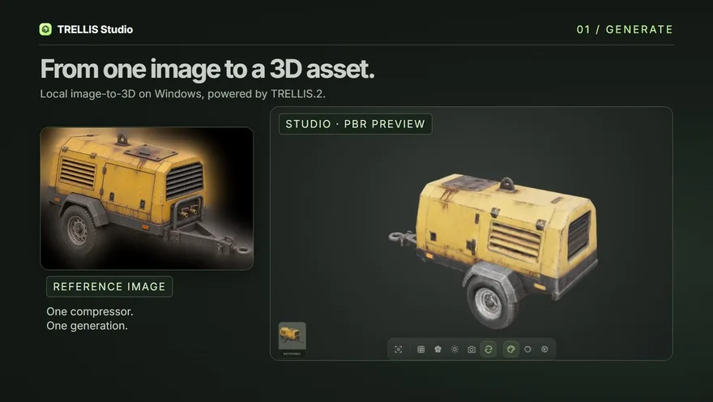
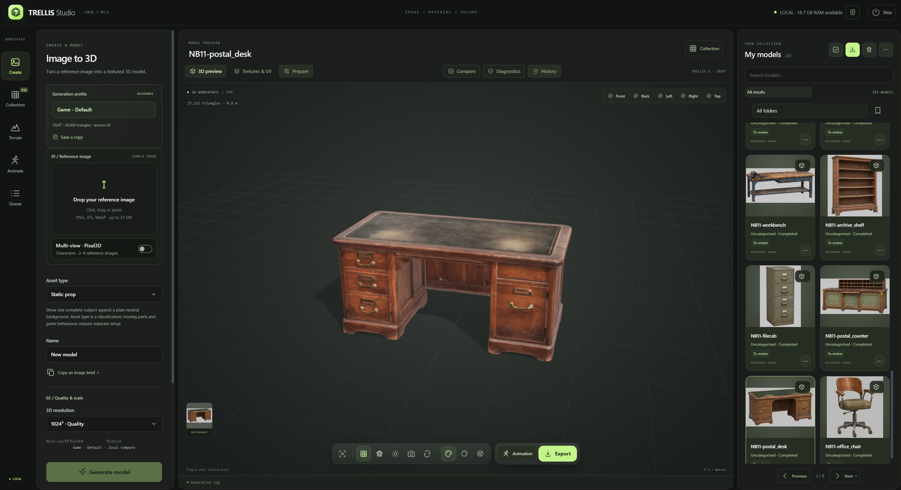
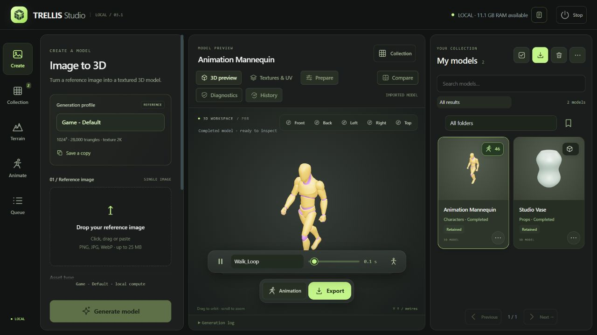
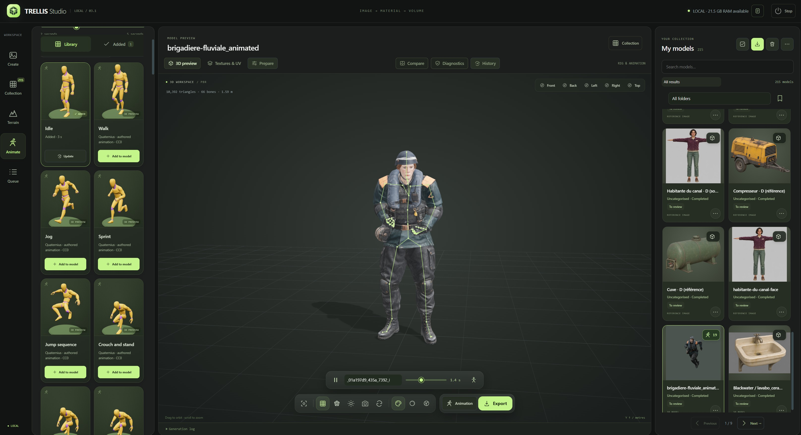
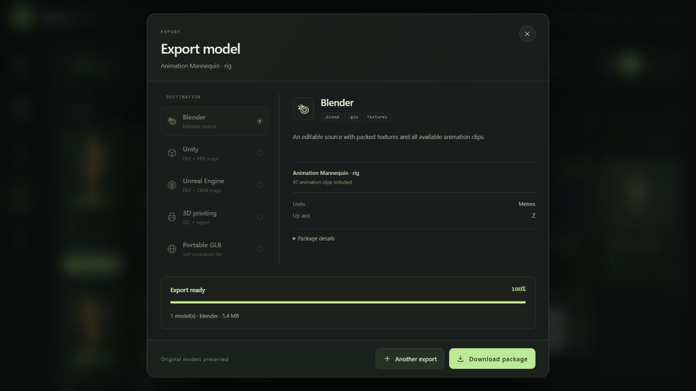

<h1 align="center">TRELLIS Studio</h1>

A local workspace for creating, preparing, rigging and animating 3D assets.

<a href="https://github.com/yoslo59/TRELLIS-Studio/releases/latest">Download Windows Setup</a> · <a href="docs/WINDOWS_SETUP.md">Setup guide</a> · <a href="docs/API.md">REST API</a> · <a href="docs/MCP.md">MCP</a> · <a href="LICENSE">MIT · Studio code</a>

TRELLIS Studio is an independent community application built around **Microsoft TRELLIS.2** and **UniRig**. Generate textured meshes from an image, import existing models, organise a collection, prepare game or printing derivatives, add a skeleton and combine authored or generated humanoid motions. Inspect everything in a browser-based PBR viewer and export for your workflow.

**Desktop** is for single-user use. **Server** gives each approved user their own library in a browser, with options for local access, LAN HTTPS and Internet HTTPS. The host runs inference and stores references and generated models. No paid inference service is required. [Server setup](docs/SERVER.md)

> **Windows x64 preview.** The maintainer tested Full Studio installation, generation and uninstallation on Windows 11 with an RTX 4070 Ti (12 GB VRAM). Installation verifies components, but output quality, deformation and target-engine suitability still need visual review. The Studio code is MIT; model and dependency licenses are separate, particularly DINOv3.

## 30-second demo

One local generation produced two finishes from the same saved source. The high-detail version has **94,170 triangles** and the **Game - Default** version has **27,568**, both with 2K PBR textures. The demo follows the lighter FBX and its materials into Unity 6.

[Download the HD video (MP4)](docs/demo/compressor-to-unity.mp4?raw=true) · [Install on Windows](#get-started)

## Get started

1. Download the latest Windows Setup executable and `SHA256SUMS.txt`. Verify the unsigned executable against the published checksum. [Latest release](https://github.com/yoslo59/TRELLIS-Studio/releases/latest)
2. Choose **TRELLIS Desktop (single user)** or **TRELLIS Server (multi-user)**. Both include the CPU Workshop for GLB import, viewing, library management and standard animation files. Install Blender separately for features such as additional import formats, FBX export and baked game copies. [Windows Setup guide](docs/WINDOWS_SETUP.md)
3. Select **TRELLIS.2 image-to-3D** for local generation. On a supported GPU, Setup offers **High Detail and Game Asset**, including the geometry engines, mesh finishing and native UltraTex. Review the FLUX.2 and MeshLib terms before installing those profiles. **Check this PC** shows the NVIDIA GPU, driver, VRAM and free disk space. [Setup requirements](docs/WINDOWS_SETUP.md#standalone-generation-profiles)
4. Open **TRELLIS Studio** or **TRELLIS Server** from the Start menu. A new Server installation guides you through creating the first administrator. [Server setup guide](docs/SERVER.md)

**Kimodo text-to-motion** is an optional CPU component. It needs initialized WSL2 Linux x64, AVX2/FMA/F16C, and at least **12 GiB free inside WSL**. Its approximately **9.3 GB** of weights are additional. [Model terms and setup](docs/MOTION_GENERATION.md)

Use **Repair or resume components** after an interrupted download. Setup verifies downloads with SHA-256. The uninstaller can stop its own idle local services and keeps the library. [Repair and uninstall](docs/WINDOWS_SETUP.md)

**New in 3.14.0** — Choose **Advanced** for humanoid rigs with twist bones
and optional articulated fingers. Use **Creature** to edit a predicted
skeleton before skinning and add procedural clips to compatible rigs.
[Release notes](docs/RELEASE_3.14.0.md)

### Install from source

[Download the source ZIP](https://github.com/yoslo59/TRELLIS-Studio/archive/refs/heads/main.zip) or clone the repository. Follow the [source installation guide](INSTALLATION.md): run **Install TRELLIS Studio.cmd**, then **Open TRELLIS.cmd**. The source launcher uses ports 7860 and 7861. It needs Node.js to assemble the viewer dependencies. Read and accept the DINOv3 license only if you agree to the terms. Setup does not enable WSL features or replace GPU drivers.

## What you can do

*Rook in Create with the reference image, output settings and PBR preview. The demonstration collection shows Rook’s game copy and rigged variant.*

| Workspace | Features |
| --- | --- |
| **Create** | Local TRELLIS.2 and Pixal3D generation with shared profiles, selectable texture methods and master finishing. Preview the cutout and framing, then crop or correct the mask while keeping the original. |
| **Queue** | Schedule batches of up to 30 images. Correct the recipe of a failed job and create a linked retry with the same references and seed. The original failure remains available for review. |
| **Collection** | Textured and clay card previews, search, category/type/review filters, favourites, tags, notes, nested folders, saved views, multiple selection and restorable trash. |
| **Review** | PBR/clay/normals/wireframe views, camera presets, adjustable lighting, roughness and metallic controls, synchronised before/after comparison, topology/UV/material/dimension diagnostics. |
| **Animate** | UniRig skeleton and skin-weight prediction, editable frontal joint markers, visible skeleton inspection, 84 authored humanoid motions, a library of generated motions and procedural motion on compatible creature rigs. |
| **Prepare** | Reference-based color projection, HD-to-game reduction and material baking, linked LOD copies, pivot and collision tools, and dedicated printing copies. |
| **History** | Parent/child lineage, recipes, comments, recoverable checkpoints and restoration as a new card. |
| **Present** | Custom thumbnails, transparent PNGs, downloadable turntables and optional lightweight turntables on individual library cards. |
| **Transfer** | Collection ZIP backup with models, sources, profiles, clips, metadata and prepared resources; optional checkpoints; verified restoration with new IDs. |
| **Automate** | Typed REST API v1, interactive OpenAPI reference and MCP tools over STDIO. Desktop also provides a local Streamable HTTP bridge. |

### Collection previews

In the 3D preview, open **Material** next to **Prepare** to adjust roughness and metallic response. Studio remembers the sliders for each model in this browser. GLB, Blender, Unity and Unreal exports apply the adjustments by default. Check **Use original materials** in Export to use the authored material for that package.

Move the pointer across a model card to compare its textured and clay renders at the same angle. When the card has keyboard focus, use the left and right arrow keys. Studio saves two WebP images per model revision. It builds missing pairs for existing models while compute jobs are idle, using Edge, Chrome or Chromium on the host. The card displays its reference image while the renders are pending or unavailable. Opening the model loads the GLB in the 3D viewer. [Browser requirements](docs/WINDOWS_SETUP.md)

In **Present your model**, **Save card turntable** records a compact six-second video for the selected model. A previous recording can be used if it fits the 6 MiB limit. Use the card's play control to watch a saved turntable.

### Try another finish

Select **HD Master** in single-image or multi-view mode to retain the full decoded geometry and material volume. Its working GLB has a default ceiling of 1.2 million triangles. Studio measures surface deviation after simplification and keeps a lighter mesh when it meets the tolerance. Increase the ceiling in the generation settings to allow more geometry when needed. Use **Keep source for finishing variants** with other profiles and **Preview reference** to check how thin parts, hands and feet survive the cutout.

Choose **Repair Holes** under **Advanced Settings → Finishing override** with HD Master to rebuild the surface before the first GLB export. Remesh displays the triangle counts of the current GLB and the cached source when known. Each variant is generated from that cache, which can contain many more triangles than the working GLB.

Choose **Balanced Reconstruction** with HD Master, or **HD Reconstruction (768)** in **Remesh** for a compatible saved source, to rebuild a cracked surface at the HD budget. The recipe uses a 768 reconstruction grid, band 1, surface projection 0, small-hole filling, and no pre-decimation. Check close-ups of seams, fingers and openings because reconstruction can soften fine geometry.

Open **Prepare → HD Master Finishing** on a model with a 1024 or 1536 cached source to create a linked dense PBR master. Choose **WTiVo 1024** with the external runtime and Blender, or **Studio 768** with the built-in reconstruction. Both methods cap the master at 3 million triangles and default to 4K textures where enabled. Studio unwraps the finished geometry and samples the cached material volume without rerunning generation. Use **Texture Projection** for further color work or **Game Copy from HD** to build a separate low-poly copy. [Workflow and engine details](docs/WTIVO.md)

On a completed model with a saved source, open **Remesh** in the viewer toolbar or **Refinish model** in the card menu.

| Model | Low | Medium (game) | High | Ultra |
| --- | ---: | ---: | ---: | ---: |
| Props and other models | 12,000 | 28,000 | 150,000 | 8,000,000 |
| Humanoids | 6,000 | 14,000 | 100,000 | 8,000,000 |

In **Fixed**, the value is a target. In **Adaptive**, it is a ceiling for the sampled surface tolerance. **Manual** accepts a custom budget and offers Direct simplification or surface rebuilding. Ultra can retain more triangles than the displayed working copy when the decoded master contains them. Large targets can take significantly longer to unwrap and bake.

**Repair holes** reconstructs a linked variant from the saved master and projects the rebuilt surface toward it to retain detail. The budget still applies. With Adaptive, Studio measures the simplification against the rebuilt surface. Review thin parts and fine edges in **Compare**, since the reconstruction can soften them or close a narrow intentional gap.

**Transfer master detail to a normal map** is enabled by default for Medium when Blender is available. It transfers the master’s surface relief into the GLB's tangent-space normal texture while keeping the finished geometry and the original material textures. View the result in **PBR** and use **Compare** to review details. Thin cables, holes and other silhouette details still depend on the finished geometry. The new card is linked to the original and variants run without neural inference.

Use **Prepare → Game Copy from HD** to place protected regions on a compatible static model. Set their radius and priority before creating a reduced copy with newly baked textures. The **Humanoid** profile already prioritizes the face and hands on an upright, front-facing T-pose. Add regions for details such as buckles, cables, handles or grille openings. Regions influence where triangles are spent within the selected budget.

Open **Finishing board** from a model card or from **Prepare**. Queue geometry variants from a saved generation cache or choose **Queue texture refinement** for a compatible textured GLB with a saved cutout. The texture copy keeps the mesh, UVs and texture size. UltraTex requires a 2K atlas. **Compare** shows the results at the same scale and camera angle.

The source cache can take hundreds of megabytes per model. Studio stores it once per source and keeps it local to this installation. Collection ZIPs preserve the finished models and recipes. The cache is optional and leaves generation profiles intact.

### Generation profiles

**HD Master** (`dense_master`) has a default ceiling of 1.2
million triangles with 2K materials. **Balanced Reconstruction** uses Studio 768
in the same job. **Surface Closure** uses WTiVo 1024 when its optional runtime and
Blender are installed. Both methods follow the displayed generation budget and
retain the decoded cache for further finishing from Prepare.

**Detail Refinement (512)** and **Detail Refinement (1024)** use an optional
Hi3D runtime to refine a native TRELLIS.2 single-image source and bake the
resulting master. The generation profile keeps its source resolution. Both
options are also available from **Finishing board**
on a compatible saved source. [Runtime setup](docs/HI3D.md)

**High Detail** and **Game Asset** offer editable workflow graphs and a choice of
geometry engine. High Detail builds a dense mesh with two geometry passes and
offers UltraTex for materials. Game Asset targets 12,000 triangles with baked
normals and UltraTex materials. [Workflow profiles](docs/NATIVE_PROFILES.md)

**High Detail (Props)** uses the TRELLIS.2 1024 cascade
with 12 / 25 / 12 sampling steps, a 300,000-triangle target and 2K textures. It
keeps the decoded source for finishing variants and selects **Multiview refinement**
when compatible. Choose a recipe and click **Use at startup** to remember it in
this browser.

**Figure Master** is a TRELLIS.2 single-image profile for characters, creatures
and statues. It uses the 1024 cascade with 30 / 35 / 12 sampling steps, a target
of 800,000 triangles and 2K textures. It keeps the source cache and selects
**Multiview refinement** when compatible. The Windows package uses Studio's
native dual contouring. Existing installations can use the separately
provisioned QuadDC and MeshLib integration. [Figure Master release notes](docs/RELEASE_3.13.0.md#figure-master)

Save a copy of a generation recipe or manage your saved profiles from Create.
**Reset profile settings** restores the selected recipe. Historical presets remain
available through saved models and the API. The API default (`game_d`) uses the
1024 TRELLIS.2 cascade, a 28,000-triangle target and 2K textures. Dimensions and
seeds belong to individual models.

512 and 1024 generation are provided by the standard installer. Higher-resolution controls require separate local capability validation and sufficient memory. Texture resolution is independent of geometry resolution.

### Texture methods

In **Create → Output Quality**, choose **Native PBR** for the engine's materials,
**Multiview refinement** to harmonize color and blend six views on compatible
single-image jobs, or **UltraTex · 2K (local preview)** for six color and six
metallic/roughness views baked to the existing 2K UV atlas. Multiview and UltraTex
require their optional runtimes. UltraTex is for private, non-commercial and
non-production evaluation under the FLUX.2 Klein 9B terms. [Windows Setup](docs/WINDOWS_SETUP.md) · [UltraTex guide](docs/ULTRATEX.md)

### Optional Pixal3D generation

Windows Setup offers Pixal3D multi-view. On a source installation, run
**Install Pixal3D.cmd**. Add the optional single-image checkpoint and MoGe-2
camera estimator by running `"Install Pixal3D.cmd" --single-image` in Command
Prompt from the Studio folder. See [optional setup](INSTALLATION.md#optional-pixal3d-generation).

In Create, use **Change** next to **Generation method**. **Pixal3D · Single image**
uses one image of an object or a character. MoGe-2 estimates its camera framing.
**Pixal3D · Multi-view** uses a front view and one to three complementary views
at consistent pose and scale. Choose the side angle that matches the references.
The left and right slots are relative to the subject. **Swap sides** switches
those images. The back slot represents 180°. References accept PNG, JPEG and
WebP up to 25 MB each. Studio prepares the cutouts and framing locally.

Both Pixal3D modes use the 1024 cascade and Studio's local queue. New monoview
jobs use 12 steps per pass. New multi-view jobs use 12 structure steps, 20 steps
in each geometry pass and 12 material steps, with guidance 7.5 / 7.5 / 1.
Replaying a saved version 1 or 2 job retains its historical 12-step
high-resolution pass. Keep the references, seed and finishing settings fixed
when comparing recipes.

Enable **Reproject the original face photo** to transfer the visible face from the original front photo into the generated base color. Use a sharp, unobstructed front view with the face large enough to see the eyes, nose and mouth. The pass runs locally after generation and keeps the existing mesh and other material maps. Check its status in the model details. If the faces cannot be aligned reliably, Studio keeps the generated texture.

The multi-view runtime uses about 8.25 GiB of pinned downloads before Python
dependencies. Single-image generation adds about 6.4 GiB. Review the
orientation, silhouette and fine details in the 3D preview.

### Import and review

Import a self-contained **GLB** of up to 500 MiB in either edition. The import retains its original bytes, embedded PBR materials, skins and clips. Desktop can also convert **FBX, OBJ, STL and PLY** through Blender when it is installed. Prepare any required external resources before importing.

Each card identifies static or animated content. Its action menu opens details, history, diagnostics, preparation, comparison, export, a linked version or trash. Use multiple selection to classify, export or remove several models together. The initial workspace leaves every model unselected.

Diagnostics report measured topology, UV presence/collapse, normals, textures, dimensions, bones and clips. These checks support review; they do not certify a final production mesh, physical printability or natural animation.

### Rigging and animation

*Animation Studio displays Rook’s rig, the Walk clip timeline and the Standard motion library.*

1. Select a completed model and open **Animation**.
2. Use **Add rig** for an unrigged character. Set its orientation, target height and vertical offset, using the fixed **1.70 m reference silhouette** for scale. Choose **Next · place joints**, then position the chin, shoulders, elbows, wrists, groin, knees and ankles. Drag markers or use the arrow keys (Shift for larger steps); disable **Mirror paired markers** for asymmetrical poses. L/R refer to the character's own sides. Confirm only after checking every point. UniRig runs in its separate WSL environment and produces a linked rigged copy.
3. Inspect the predicted skeleton against the model, including hands, feet, joints and proportions.
4. Browse or search the animation cards on the left. Choose **2–5 seconds** and **Add to model**.
5. Add more clips to that **same model and card**. Updating a clip preserves the others. Existing custom clips are retained.
6. Select clips, play/pause, inspect the skeleton or use the motion workshop to trim/resample, blend a loop and choose in-place or root motion. Motion edits create a checkpoint and update prepared skinned LODs.

The initial markers are editable guides, not automatic landmark detection. Manual placement supports upright humanoids in an A-pose or T-pose: frontal positions constrain the predicted skeleton **before skin weights are calculated**, while UniRig retains its predicted depth. Ambiguous skeleton mappings stop with an error rather than ignoring the markers. This step does not rebuild mesh anatomy or add a facial rig. Existing skins can still be retained through the API without new landmarks; editing an already skinned skeleton is a separate workflow.

Choose **Advanced** on the original unrigged humanoid to add forearm twist bones.
Use rigid hands for simple geometry or enable **Articulated fingers** on a character
whose fingers are separated. Auto uses the existing humanoid rigging workflow.

Choose **Creature** for an unrigged non-humanoid mesh. Review the predicted skeleton
in the 3D editor, adjust endpoints or edit chains, then calculate skin weights.
Choose a deformation check or a procedural quadruped, serpentine or wing-flap
preview loop. Review the result before exporting GLB or FBX. The preview loops
depend on the skeleton anatomy.

On a completed skinned model, open the **Creature** tab in Animation. Studio
checks the existing hierarchy and shows the loops it can generate. Adjust duration,
cycle count and intensity, then save the clip on the same model. **Creature swim**
contracts and reopens the bell and offers controls for wave delay and vertical
travel. Review playback from **Added**. Independent tentacle motion depends on the
existing bones and skin weights.

The library uses the **free Standard editions** of Quaternius Universal Animation Libraries 1 and 2 under **CC0-1.0**. Entries cover locomotion, crouching, jumping, a ledge climb with root motion, interactions, combat, reactions and emotes. Card previews show each motion on its source mannequin. The retargeter adapts timing, body and finger rotations, and root travel to the fitted rig. Review grips, foot contacts, props and transitions on the target character.

**My animations** adds optional text-to-motion generation for humanoids. Describe an action, choose 2–10 seconds and keep the result as a reusable 3D preview card. **Add to model** appends the saved motion to the selected rigged model, keeping the same collection card and its existing clips; already attached motions show **Added**. Standard animation additions also update the selected model. REST and MCP expose the same workflow. Windows Setup can install and configure the experimental CPU engine after explicit selection and licence acceptance, or you can add it later with **Install Kimodo motion generation**. On Server, a new motion costs one credit for a standard account; reusing a saved motion costs none. See [generated motions and runtime setup](docs/MOTION_GENERATION.md).

Foot-contact measurements are estimates. The workshop does not guarantee foot locking or remove every instance of foot sliding. Generated motions do not provide detailed finger animation or guaranteed hand-to-object contacts. Facial animation, automatic gameplay controllers and video-to-motion are not features of this version.

### Game and printing preparation

**Texture Projection** starts from a completed static GLB. With a cutout
reference, open the camera menu and choose **Auto Align** to estimate the
view and fit the overlay. Review the result and use **Orbit** or paired
guides for precise alignment. Symmetric shapes and differences between
the mesh and the reference can make the angle ambiguous. Presets such as
**Back** are available for straightforward views. Select an area with the
lasso, polygon, rectangle or ellipse. The preview camera determines which
visible surfaces receive the projected base color. Add a second view to cover
another side of the model, and align and mask it independently. Studio blends
overlapping contributions according to their visibility and viewing angle.
The linked copy keeps the source geometry, UVs and other maps.

For a compatible Pixal3D generation with saved camera data, choose
**Use generation views** to project the original prepared views with
Pixel Match. It uses visibility, edge blending and local color matching,
and creates a linked texture copy. On supported single-image TRELLIS.2
generations, Studio can fit the saved reference to the model for projection.
Use the manual editor to load a custom reference, adjust its position and
scale, or review an Auto Align result.

**Game Copy from HD** reduces the selected static HD model, unwraps new UVs,
and bakes base color, roughness, metallic and optional tangent-space normals
from that master. Start with 28,000 triangles for an object or 14,000 for a
frontal T-pose humanoid. Inspect faces, hands, thin parts and materials in
**Compare**. Blender is required for this operation.

**Automatic LODs** create a linked copy containing full-detail LOD 0 and reduced meshes, preserving available UV/material/skin data. Compare silhouettes with synchronised cameras and export the group.

**Game preparation** creates a separate model with a useful pivot, centring, rotation, scale, offsets and box or convex collision. The studio does not overwrite the selected original.

**3D print copy** grounds and sizes a rest-pose mesh, reconstructs overlapping surfaces with Blender's voxel remesher, repairs small boundary loops and writes a dedicated GLB, STL and topology report. Choose height in millimetres and voxel detail. The reconstruction grid is capped at 384 samples on the longest axis. This can soften small features. Check wall thickness, supports, tolerances, disconnected shells and stability in your slicer.

### Export

| Destination | Contents | Convention |
| --- | --- | --- |
| **Portable GLB** | Self-contained geometry, selected PBR materials, rig and embedded clips | Metres, Y up |
| **Blender** | Editable packed `.blend`, GLB and material maps | Metres, Z up |
| **Unity** | Animated FBX, PBR maps, optional Editor importer; prepared LOD/collision resources | Metres, Y up |
| **Unreal Engine** | Animated FBX, ORM maps and DirectX normal maps | Centimetres, Z up |
| **3D printing** | Dedicated STL and topology report; create a print copy first | Millimetres, Z up |
| **Unity terrain** | Heightmap, terrain textures and Editor importer from a procedural Terrain card | Metres, Y up |

Exports run as separate cancellable jobs and provide downloadable ZIPs. Engine packages accept up to 50 completed models. A collection backup accepts up to 500 models.

For Unity, merge the exported common `Editor` folder into your project, then choose **Tools → TRELLIS Studio → Configure exported models**. It configures materials, Generic animation/avatar settings and, for prepared copies, a prefab with LODGroup and collisions. Skinned LODs follow LOD 0's bones. Humanoid avatar mapping, controllers and gameplay remain project-specific. Unreal imports still require checking material assignment and normal settings.

In Export, choose **Check model** to measure the asset against editable budgets for its destination and intended use. The report distinguishes checks from the review decision; topology diagnostics can show open and non-manifold edges on a static model. Exported reports identify the GLB measured during preflight by its SHA-256 hash.

To update a Unity asset, extract the new package **outside** `Assets`, select the existing model folder in Unity and choose **Tools → TRELLIS Studio → Preview model update**. Point it to the incoming `studio-export.json`. Review the changes and select the files to update. The importer checks that existing object references still resolve and leaves your materials and prefab edits in place. If the mesh was re-UV-mapped, include its matching textures. Existing projects can install the updated Editor helper without replacing their assets.

## API and agents

The header's **API & MCP** icon opens the developer workspace. Desktop uses
loopback for the API and Streamable HTTP bridge.

| Service | Windows Setup default | Source installation default |
| --- | --- | --- |
| Studio | `http://127.0.0.1:7870/` | `http://127.0.0.1:7860/` |
| Developer workspace | `http://127.0.0.1:7870/developers` | `http://127.0.0.1:7860/developers` |
| Interactive API reference | `http://127.0.0.1:7870/api/docs` | `http://127.0.0.1:7860/api/docs` |
| OpenAPI | `http://127.0.0.1:7870/api/openapi.json` | `http://127.0.0.1:7860/api/openapi.json` |
| REST v1 | `http://127.0.0.1:7870/api/v1` | `http://127.0.0.1:7860/api/v1` |
| MCP Streamable HTTP | `http://127.0.0.1:7871/mcp` | `http://127.0.0.1:7861/mcp` |

Documentation JavaScript/CSS is served locally. The launcher starts the API and HTTP MCP bridge together. STDIO clients launch `.mcp-venv/Scripts/python.exe trellis_mcp.py` using absolute paths. See the [MCP guide](docs/MCP.md) for Codex registration, client JSON and connection details, and the [REST guide](docs/API.md) for uploads, recipes, async jobs, preparation and downloads.

The MCP tools cover library search, import/generation, queue control, classification, collections, history, diagnostics, LOD/game/print copies, rigging, animations, export and restorable trash. Long operations return job IDs; agents poll progress. Client approval settings remain controlled by the host agent application.

For remote access, use the authenticated **Server** edition with your configured HTTPS origin and a personal API key. Configure the client's STDIO bridge with `TRELLIS_API_URL` for the Server origin and `TRELLIS_API_TOKEN` for the key. The Desktop HTTP MCP bridge stays on loopback. [Server client setup](docs/SERVER.md#connect-a-script-or-mcp-client) · [Security](SECURITY.md)

## Local files and updates

| Location | Purpose |
| --- | --- |
| `outputs/`, `trash/` | Your library, sources, derivatives and recoverable deleted items |
| `config/` | Personal profiles, workspace/queue state and runtime settings |
| `config/studio-state/generated-animations/` | Desktop's default persistent motion library; Server keeps a separate library within each account's workspace |
| `exports/`, `logs/` | Prepared export packages and local service logs |
| `models/`, `UniRig/models/`, `engine/MODELS/` | Downloaded weights |
| `engine/`, `UniRig/source/` | Pinned third-party engines downloaded during setup |
| `.venv/`, `.mcp-venv/`, `.tools/`, `.downloads/`, `node_modules/` | Private environments, tools and caches |

These locations are excluded from Git. This repository contains application code, necessary runtime adapters/patches, install manifests, public documentation, license notices and demonstration screenshots. It contains no personal models.
Back up your collection before upgrading. For an existing packaged installation, stop Studio or Server and rerun Setup in the same installation folder. Source installations have a separate update procedure. Keep the application at its installed path because moving Python virtual environments requires recreating them. [Windows update guide](docs/WINDOWS_SETUP.md) · [Source update guide](INSTALLATION.md#updating-and-uninstalling)

## Credits and licenses

Studio's original code is released under the **[MIT License](LICENSE)** by **[yoslo59](https://github.com/yoslo59)**. Third-party code, weights, animation sources and tools retain their own licenses; installing this application does not relicense them.

| Project / authors | Role | License / source |
| --- | --- | --- |
| [Microsoft TRELLIS.2](https://github.com/microsoft/TRELLIS.2) | Image-to-3D engine and pretrained assets | MIT; [model card](https://huggingface.co/microsoft/TRELLIS.2-4B) |
| [Igor Aherne's Windows port](https://github.com/IgorAherne/TRELLIS.2-stableprojectorz), [andrakis fork](https://github.com/andrakis/TRELLIS.2-stableprojectorz) | Validated Windows/low-VRAM runtime and compatibility work | MIT; pinned revision in the installer manifest |
| [UniRig · VAST AI Research / Tripo / Tsinghua](https://github.com/VAST-AI-Research/UniRig) | Skeleton and skin-weight prediction | MIT code; [MIT model card](https://huggingface.co/VAST-AI/UniRig) |
| [Meta DINOv3](https://github.com/facebookresearch/dinov3) | Image conditioning | **Custom DINOv3 License**, with use conditions; [terms](licenses/DINOv3-LICENSE.md) |
| [Quaternius](https://quaternius.com/) | Authored animation sources and demonstration mannequin | CC0-1.0; [UAL 1](https://quaternius.com/packs/universalanimationlibrary.html), [UAL 2](https://quaternius.com/packs/universalanimationlibrary2.html) |
| [Blender](https://github.com/blender/blender) | Import/export, preparation, rig/animation authoring | GPL; installed separately; [licensing](https://www.blender.org/about/license/) |
| [PyTorch](https://github.com/pytorch/pytorch) | Tensor/CUDA inference | BSD-3-Clause and dependency notices |
| [Three.js](https://github.com/mrdoob/three.js) | Interactive browser viewer | MIT |
| [FastAPI](https://github.com/fastapi/fastapi), [Uvicorn](https://github.com/Kludex/uvicorn) | Local HTTP services | MIT / BSD-3-Clause |
| [MCP Python SDK](https://github.com/modelcontextprotocol/python-sdk) | Agent bridge | MIT |

The complete [third-party credits and license notes](THIRD_PARTY_NOTICES.md) cover mesh/CUDA libraries, the Python/web stack, background removal, installation tools and animation provenance. Model-use rights and rights to an input image remain separate from the MIT license on Studio itself. There is no blanket claim that every dependency or generated asset is unrestricted for every use.

## Support and contributing

Use [GitHub Issues](https://github.com/yoslo59/TRELLIS-Studio/issues) for reproducible problems. Include Windows version, GPU/VRAM, driver, installer stage, relevant dependency versions and a redacted error excerpt. Avoid uploading tokens, personal files, the full library or unredacted configuration/logs. A minimal model can help only when you have the right to share it.

Documentation improvements and focused fixes are welcome. Follow the contribution guide for local checks and reproducible pull requests, and read the code of conduct before participating. [Contributing guide](https://github.com/yoslo59/TRELLIS-Studio/blob/main/CONTRIBUTING.md) · [Code of conduct](https://github.com/yoslo59/TRELLIS-Studio/blob/main/CODE_OF_CONDUCT.md)

Follow the security policy when reporting vulnerabilities. [Security policy](SECURITY.md)
