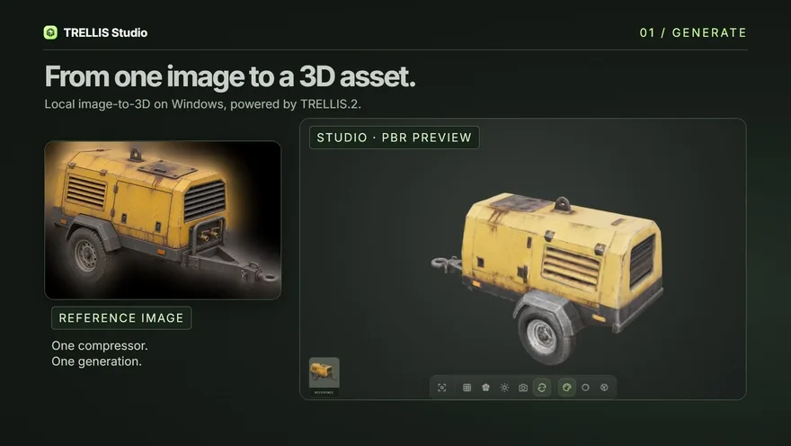
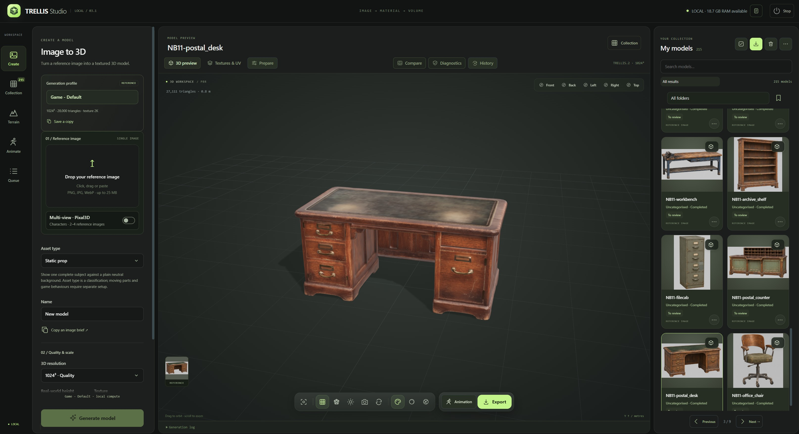
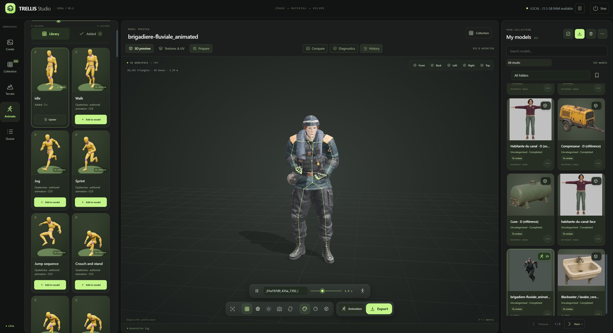
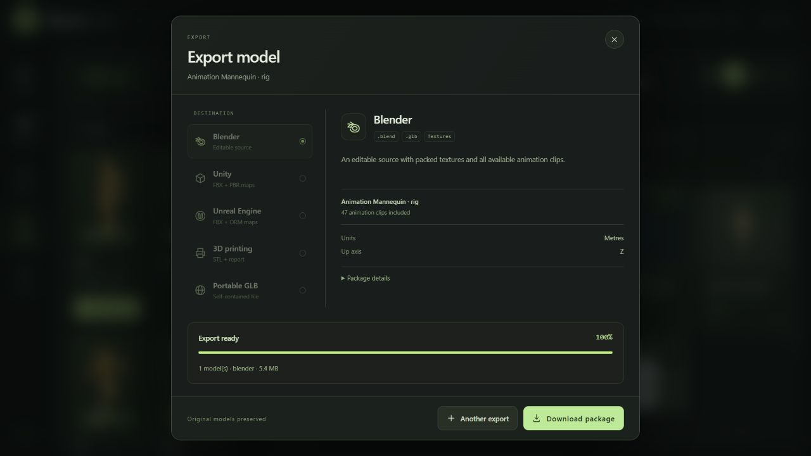

<h1 align="center">TRELLIS Studio</h1>

A local workspace for creating, preparing, rigging and animating 3D assets.

<a href="LICENSE">MIT · Studio code</a> · <a href="INSTALLATION.md">Installation</a> · <a href="docs/API.md">REST API</a> · <a href="docs/MCP.md">MCP</a> · <a href="THIRD_PARTY_NOTICES.md">Credits & licenses</a>

TRELLIS Studio is an independent community application built around **Microsoft TRELLIS.2** and **UniRig**. Generate textured meshes from an image, import existing models, organise a collection, prepare game or printing derivatives, add a skeleton and attach multiple authored animations to the same model. Inspect everything in a browser-based PBR viewer and export for your workflow.

Inference runs on the computer hosting TRELLIS. **Desktop** is for single-user use, and **Server** lets people on a private network access their own libraries in a browser. References and generated models stay on the host. Studio generation does not require a paid service.

> **Windows x64 preview.** The maintainer tested Full Studio installation, generation and uninstallation on Windows 11 with an RTX 4070 Ti (12 GB VRAM). Installation verifies components, but output quality, deformation and target-engine suitability still need visual review. The Studio code is MIT; model and dependency licenses are separate, particularly DINOv3.

## 30-second demo

One local generation produced two finishes from the same saved source. The high-detail version has **94,170 triangles** and the **Game - Default** version has **27,568**, both with 2K PBR textures. The demo follows the lighter FBX and its materials into Unity 6.

[Download the HD video (MP4)](docs/demo/compressor-to-unity.mp4?raw=true) · [Install on Windows](#get-started)

## Get started

1. Download the x64 Setup from [GitHub Releases](https://github.com/yoslo59/TRELLIS-Studio/releases). This preview is unsigned; the release also includes its SHA-256 checksum.
2. Choose **TRELLIS Desktop (single user)** or **TRELLIS Server (multi-user)**. Both editions offer **Workshop only** for the library, 3D viewer and GLB import/export, or **Full Studio** for TRELLIS.2 generation, UniRig and Pixal3D. Full Studio requires a compatible NVIDIA driver, Blender and Ubuntu 22.04 under WSL2. Allow around **29 GiB** of model downloads plus packages and **100 GiB** of free space.
3. Open **TRELLIS Studio** or **TRELLIS Server** from the Start menu. Setup can add a desktop shortcut. A new Server installation guides you through creating the first administrator. See the [Server setup guide](docs/SERVER.md) for network access, account approval, quotas and personal API keys.

Read the [Windows Setup guide](docs/WINDOWS_SETUP.md) for component installation, repair and uninstall. Downloads are resumable and verified with SHA-256. The uninstaller can stop its own idle local services and keeps the library.

### Install from source

[Download the source ZIP](https://github.com/yoslo59/TRELLIS-Studio/archive/refs/heads/main.zip) or clone the repository. Follow the [source installation guide](INSTALLATION.md): run **Install TRELLIS Studio.cmd**, then **Open TRELLIS.cmd**. The source launcher uses ports 7860 and 7861. It needs Node.js to assemble the viewer dependencies. Read and accept the DINOv3 license only if you agree to the terms. Setup does not enable WSL features or replace GPU drivers.

## What you can do

*The Create workspace combines the generation profile, reference image card, PBR preview and local collection. The pictured assets are not included in this repository.*

| Workspace | Features |
| --- | --- |
| **Create** | Local TRELLIS.2 single-image generation and optional Pixal3D multi-view characters. Preview the cutout and the model's framing, then crop or correct the mask without changing the original. |
| **Queue** | Schedule batches of up to 30 images. Correct the recipe of a failed job and create a linked retry with the same references and seed. The original failure remains available for review. |
| **Collection** | Search, category/type/review filters, favourites, tags, notes, nested folders, saved views, multiple selection, restorable trash and per-card action menus. |
| **Review** | PBR/clay/normals/wireframe views, camera presets, adjustable preview lighting, synchronised before/after comparison, topology/UV/material/dimension diagnostics. |
| **Animate** | UniRig skeleton and skin-weight prediction, size comparison with a flat 1.70 m human silhouette, editable frontal joint markers, visible skeleton inspection and 83 authored humanoid animation entries. |
| **Prepare** | Linked LOD copies, pivots, centring, orientation, scale and box/convex collisions; dedicated printing copies with STL and topology reports. |
| **History** | Parent/child lineage, recipes, comments, recoverable checkpoints and restoration as a new card. |
| **Present** | Custom thumbnails, transparent PNGs, downloadable turntables and optional lightweight turntables on individual library cards. |
| **Transfer** | Collection ZIP backup with models, sources, profiles, clips, metadata and prepared resources; optional checkpoints; verified restoration with new IDs. |
| **Automate** | Typed REST API v1, interactive OpenAPI reference and MCP tools over STDIO. Desktop also provides a local Streamable HTTP bridge. |

In **Present your model**, **Save card turntable** records a compact six-second preview for the selected model. Use a previous recording if it fits the 6 MiB limit, or remove the preview from the card at any time. Cards keep their still thumbnails and load one preview at a time on hover or explicit playback.

### Try another finish

Select **Dense Master** in single-image or multi-view mode to retain the full decoded geometry and material volume. Its working GLB has a default ceiling of 1.2 million triangles. Studio measures surface deviation after simplification and keeps a lighter mesh when it meets the tolerance. Increase the ceiling in the generation settings to allow more geometry when needed. Use **Keep source for finishing variants** with other profiles and **Preview reference** to check how thin parts, hands and feet survive the cutout.

Enable **Repair holes on the working mesh** with Dense Master to rebuild the surface before the first GLB export. The decoded cache is retained for later variants. Remesh displays the triangle counts of the current GLB and the cached source when known. Each variant is generated from that cache, which can contain many more triangles than the working GLB.

On a completed model with a saved source, open **Remesh** in the viewer toolbar or **Refinish model** in the card menu.

| Model | Low | Medium (game) | High | Ultra |
| --- | ---: | ---: | ---: | ---: |
| Props and other models | 12,000 | 28,000 | 150,000 | 8,000,000 |
| Humanoids | 6,000 | 14,000 | 100,000 | 8,000,000 |

In **Fixed**, the value is a target. In **Adaptive**, it is a ceiling for the sampled surface tolerance. **Manual** accepts a custom budget and offers Direct simplification or surface rebuilding. Ultra can retain more triangles than the displayed working copy when the decoded master contains them. Large targets can take significantly longer to unwrap and bake.

**Repair holes** reconstructs a linked variant from the saved master and projects the rebuilt surface toward it to retain detail. The budget still applies. With Adaptive, Studio measures the simplification against the rebuilt surface. Review thin parts and fine edges in **Compare**, since the reconstruction can soften them or close a narrow intentional gap.

**Transfer master detail to a normal map** is enabled by default for Medium when Blender is available. It transfers the master’s surface relief into the GLB's tangent-space normal texture while keeping the finished geometry and the original material textures. View the result in **PBR** and use **Compare** to review details. Thin cables, holes and other silhouette details still depend on the finished geometry. The new card is linked to the original and variants run without neural inference.

Open **Finishing board** from the same card or from **Prepare** to queue several editable finishing recipes from one cache. Compare the measured results at their original scale with the camera held in place, then mark the preferred version. That choice is recorded separately from the asset's visual review.

The source cache can take hundreds of megabytes per model. Studio stores it once per source and keeps it local to this installation. Collection ZIPs preserve the finished models and recipes. The cache is optional and leaves generation profiles intact.

### Generation profiles

Create opens with **Dense Master**. Its default 1.2 million triangles is an editable ceiling for the displayed GLB. Studio measures how closely smaller candidates follow the decoded surface, or the reconstructed surface when repair is enabled. It keeps the full geometry and materials cache for Remesh. **3D print copy** uses the selected GLB. Choose another recipe and click **Use at startup** to remember it in this browser. The API default and **Reset to Game - Default** use the game recipe.

**Game - Default** (`game_d`) uses the validated 1024 cascade recipe: 20 steps per phase, guidance 7.5 / 7.5 / 2, approximately 28,000 target triangles, 2K textures, 2M pre-simplification, initial small-hole repair and DC remeshing capped at 512. Final triangle count is approximate. Dimensions and seeds belong to individual models.

**High Detail** retains the 1024/20-step/2K sampling setup, targets 250,000 triangles and uses direct simplification to preserve more surface detail. Create custom profiles when you need another recipe; the built-in profiles remain protected. Historical recipes remain readable.

**Humanoid · Experimental** (`humanoid_experimental`) is an optional comparison recipe: 1024 cascade, 250,000 target triangles, 2K materials and direct simplification. It retains the decoded source automatically and classifies the result as a humanoid. Inspect this detailed master, then use **Refinish model** to compare lighter copies around 10,000–14,000 triangles without generating again. The single-image sampler uses D’s 20-step setup; the Pixal3D version keeps its existing multi-view sampler. It does not automatically reconstruct or replace the face and hands, bake a new high-to-low normal map, generate extra reference views or add a rig. Those anatomy experiments remain separate.

512 and 1024 generation are provided by the standard installer. Higher-resolution controls require separate local capability validation and sufficient memory. Texture resolution is independent of geometry resolution.

### Optional multi-view characters

**Full Studio** includes Pixal3D. On a source installation, run **Install Pixal3D.cmd** after the main installation to add it. In the **Reference image** card in **Create**, enable **Multi-view · Pixal3D**, add a full-body front image and at least one complementary view, then choose the side angle that matches the images. The left and right slots are relative to the character. The back is a 180° view. Use the same character, scale and A-pose or T-pose in each image, with hands and feet visible. The slots accept PNG, JPEG and WebP up to 25 MB each. Studio prepares the cutouts and framing locally. Supply the views yourself.

The separate **Character · Pixal3D** recipe uses the 1024 cascade, a target of 10,600 triangles and 2K materials. The mesh and materials are generated in successive stages. Actual triangle counts are approximate. Jobs share Studio's queue and retain their input views, angles and recipe. The source cache for **Refinish model** is optional for this standard recipe. The **Character profile** selector also offers **Humanoid · Experimental**, which keeps the source and targets a detailed 250,000-triangle master before lighter finishing comparisons, and **Dense Master**, which adapts the displayed GLB to the surface under the selected ceiling.

New Pixal3D jobs use 12 structure steps, 20 steps in each geometry pass and 12 material steps, with guidance 7.5 / 7.5 / 1. Recipe version 3 makes the geometry step count apply to both passes. Replaying a saved version 1 or 2 job retains its historical 12-step high-resolution pass. Increasing steps does not guarantee finer anatomy. Keep the references, seed and finishing settings fixed when comparing recipes.

Enable **Reproject the original face photo** to transfer the visible face from the original front photo into the generated base color. Use a sharp, unobstructed front view with the face large enough to see the eyes, nose and mouth. The pass runs locally after generation and keeps the existing mesh and other material maps. Check its status in the model details. If the faces cannot be aligned reliably, Studio keeps the generated texture.

The optional runtime uses about 8.25 GiB of pinned downloads before Python dependencies. The tested configuration used three views on an RTX 4070 Ti with 12 GB VRAM. Review the face, fingers and silhouette before use. [Optional setup](INSTALLATION.md#optional-pixal3d-multi-view)

### Import and review

Import a self-contained **GLB, FBX, OBJ, STL or PLY**, up to 500 MB. A self-contained GLB retains its original bytes, embedded PBR materials, skins and clips. Other formats are converted through a private Blender process; external resources should be embedded or prepared before importing.

Each card identifies static or animated content. Its action menu opens details, history, diagnostics, preparation, comparison, export, a linked version or trash. Use multiple selection to classify, export or remove several models together. The initial workspace leaves every model unselected.

Diagnostics report measured topology, UV presence/collapse, normals, textures, dimensions, bones and clips. These checks support review; they do not certify a final production mesh, physical printability or natural animation.

### Rigging and animation

*An imported character with its skeleton visible, animation timeline and clip library. Studio supports both generated and imported models.*

1. Select a completed model and open **Animation**.
2. Use **Add rig** for an unrigged character. Set its orientation, target height and vertical offset, using the fixed **1.70 m reference silhouette** for scale. Choose **Next · place joints**, then position the chin, shoulders, elbows, wrists, groin, knees and ankles. Drag markers or use the arrow keys (Shift for larger steps); disable **Mirror paired markers** for asymmetrical poses. L/R refer to the character's own sides. Confirm only after checking every point. UniRig runs in its separate WSL environment and produces a linked rigged copy.
3. Inspect the predicted skeleton against the model, including hands, feet, joints and proportions.
4. Browse or search the animation cards on the left. Choose **2–5 seconds** and **Add to model**.
5. Add more clips to that **same model and card**. Updating a clip preserves the others. Existing custom clips are retained.
6. Select clips, play/pause, inspect the skeleton or use the motion workshop to trim/resample, blend a loop and choose in-place or root motion. Motion edits create a checkpoint and update prepared skinned LODs.

The initial markers are editable guides, not automatic landmark detection. Manual placement supports upright humanoids in an A-pose or T-pose: frontal positions constrain the predicted skeleton **before skin weights are calculated**, while UniRig retains its predicted depth. Ambiguous skeleton mappings stop with an error rather than ignoring the markers. This step does not rebuild mesh anatomy or add a facial rig. Existing skins can still be retained through the API without new landmarks; editing an already skinned skeleton is a separate workflow.

The library uses the **free Standard editions** of Quaternius Universal Animation Libraries 1 and 2, under **CC0-1.0**. Entries cover locomotion, crouching, jumping, interaction, combat, reactions, emotes and other game actions. Card previews show authored motion on its source mannequin. Paid packs are not included. The retargeter adapts timing, body/finger rotations and root travel to the fitted rig; extreme proportions, clothing, skin weights, contacts and transitions can still need manual work.

Foot-contact measurements are estimates. The workshop does not guarantee foot locking or remove every instance of foot sliding. Facial animation, automatic gameplay controllers, text-to-motion and video-to-motion are not features of this version.

### Game and printing preparation

**Automatic LODs** create a linked copy containing full-detail LOD 0 and reduced meshes, preserving available UV/material/skin data. Compare silhouettes with synchronised cameras and export the group.

**Game preparation** creates a separate model with a useful pivot, centring, rotation, scale, offsets and box or convex collision. The studio does not overwrite the selected original.

**3D print copy** grounds and sizes a rest-pose mesh, reconstructs overlapping surfaces with Blender's voxel remesher, repairs small boundary loops and writes a dedicated GLB, STL and topology report. Choose height in millimetres and voxel detail. The reconstruction grid is capped at 384 samples on the longest axis. This can soften small features. Check wall thickness, supports, tolerances, disconnected shells and stability in your slicer.

### Export

| Destination | Contents | Convention |
| --- | --- | --- |
| **Portable GLB** | Original self-contained geometry, PBR, rig and embedded clips | Metres, Y up |
| **Blender** | Editable packed `.blend`, original GLB and material maps | Metres, Z up |
| **Unity** | Animated FBX, PBR maps, optional Editor importer; prepared LOD/collision resources | Metres, Y up |
| **Unreal Engine** | Animated FBX, ORM maps and DirectX normal maps | Centimetres, Z up |
| **3D printing** | Dedicated STL and topology report; create a print copy first | Millimetres, Z up |
| **Unity terrain** | Heightmap, terrain textures and Editor importer from a procedural Terrain card | Metres, Y up |

Exports run as separate cancellable jobs and provide downloadable ZIPs. Engine packages accept up to 50 completed models. A collection backup accepts up to 500 models.

For Unity, merge the exported common `Editor` folder into your project, then choose **Tools → TRELLIS Studio → Configure exported models**. It configures materials, Generic animation/avatar settings and, for prepared copies, a prefab with LODGroup and collisions. Skinned LODs follow LOD 0's bones. Humanoid avatar mapping, controllers and gameplay remain project-specific. Unreal imports still require checking material assignment and normal settings.

In Export, choose **Check model** to measure the asset against editable budgets for its destination and intended use. The report distinguishes checks from the review decision; topology diagnostics can show open and non-manifold edges on a static model. Exported reports refer to the exact source GLB in the export.

To update a Unity asset, extract the new package **outside** `Assets`, select the existing model folder in Unity and choose **Tools → TRELLIS Studio → Preview model update**. Point it to the incoming `studio-export.json`. Review the changes and select the files to update. The importer checks that existing object references still resolve and leaves your materials and prefab edits in place. If the mesh was re-UV-mapped, include its matching textures. Existing projects can install the updated Editor helper without replacing their assets.

## API and agents

The header's **API & MCP** icon opens the English developer workspace:

- Studio: `http://127.0.0.1:7860/`
- Developer workspace: `http://127.0.0.1:7860/developers`
- Interactive API reference: `http://127.0.0.1:7860/api/docs`
- OpenAPI: `http://127.0.0.1:7860/api/openapi.json`
- REST base: `http://127.0.0.1:7860/api/v1`
- MCP Streamable HTTP: `http://127.0.0.1:7861/mcp`

Documentation JavaScript/CSS is served locally. The launcher starts the API and HTTP MCP bridge together. STDIO clients launch `.mcp-venv/Scripts/python.exe trellis_mcp.py` using absolute paths. See the [MCP guide](docs/MCP.md) for Codex registration, client JSON and connection details, and the [REST guide](docs/API.md) for uploads, recipes, async jobs, preparation and downloads.

The MCP tools cover library search, import/generation, queue control, classification, collections, history, diagnostics, LOD/game/print copies, rigging, animations, export and restorable trash. Long operations return job IDs; agents poll progress. Client approval settings remain controlled by the host agent application.

ChatGPT web access needs a separately configured reachable/private connection; it cannot contact this computer's loopback URL directly. Studio creates no tunnel or public hosting. API/MCP endpoints bind to loopback and have no remote authentication service. See [security and local access](SECURITY.md) before considering remote deployment.

## Local files and updates

| Location | Purpose |
| --- | --- |
| `outputs/`, `trash/` | Your library, sources, derivatives and recoverable deleted items |
| `config/` | Personal profiles, workspace/queue state and runtime settings |
| `exports/`, `logs/` | Prepared export packages and local service logs |
| `models/`, `UniRig/models/`, `engine/MODELS/` | Downloaded weights |
| `engine/`, `UniRig/source/` | Pinned third-party engines downloaded during setup |
| `.venv/`, `.mcp-venv/`, `.tools/`, `.downloads/`, `node_modules/` | Private environments, tools and caches |

These locations are excluded from Git. This repository contains application code, necessary runtime adapters/patches, install manifests, public documentation, license notices and demonstration screenshots. It contains no personal models.
Back up a collection through the application before upgrading. Updating source code is separate from replacing a user library. Re-run the installer to restore missing prerequisites or verified downloads. It preserves unrecognised files instead of deleting them. Keep the application at its installed path; moving Python virtual environments requires recreating them.

## Credits and licenses

Studio's original code is released under the **[MIT License](LICENSE)** by **[yoslo59](https://github.com/yoslo59)**. Third-party code, weights, animation sources and tools retain their own licenses; installing this application does not relicense them.

| Project / authors | Role | License / source |
| --- | --- | --- |
| [Microsoft TRELLIS.2](https://github.com/microsoft/TRELLIS.2) | Image-to-3D engine and pretrained assets | MIT; [model card](https://huggingface.co/microsoft/TRELLIS.2-4B) |
| [Igor Aherne's Windows port](https://github.com/IgorAherne/TRELLIS.2-stableprojectorz), [andrakis fork](https://github.com/andrakis/TRELLIS.2-stableprojectorz) | Validated Windows/low-VRAM runtime and compatibility work | MIT; pinned revision in the installer manifest |
| [UniRig · VAST AI Research / Tripo / Tsinghua](https://github.com/VAST-AI-Research/UniRig) | Skeleton and skin-weight prediction | MIT code; [MIT model card](https://huggingface.co/VAST-AI/UniRig) |
| [Meta DINOv3](https://github.com/facebookresearch/dinov3) | Image conditioning | **Custom DINOv3 License**, with use conditions; [terms](licenses/DINOv3-LICENSE.md) |
| [Quaternius](https://quaternius.com/) | Authored animation sources and demonstration mannequin | CC0-1.0; [UAL 1](https://quaternius.com/packs/universalanimationlibrary.html), [UAL 2](https://quaternius.com/packs/universalanimationlibrary2.html) |
| [Blender](https://github.com/blender/blender) | Import/export, preparation, rig/animation authoring | GPL; installed separately; [licensing](https://www.blender.org/about/license/) |
| [PyTorch](https://github.com/pytorch/pytorch) | Tensor/CUDA inference | BSD-3-Clause and dependency notices |
| [Three.js](https://github.com/mrdoob/three.js) | Interactive browser viewer | MIT |
| [FastAPI](https://github.com/fastapi/fastapi), [Uvicorn](https://github.com/Kludex/uvicorn) | Local HTTP services | MIT / BSD-3-Clause |
| [MCP Python SDK](https://github.com/modelcontextprotocol/python-sdk) | Agent bridge | MIT |

The complete [third-party credits and license notes](THIRD_PARTY_NOTICES.md) cover mesh/CUDA libraries, the Python/web stack, background removal, installation tools and animation provenance. Model-use rights and rights to an input image remain separate from the MIT license on Studio itself. There is no blanket claim that every dependency or generated asset is unrestricted for every use.

## Support

Use [GitHub Issues](https://github.com/yoslo59/TRELLIS-Studio/issues) for reproducible problems. Include Windows version, GPU/VRAM, driver, installer stage, relevant dependency versions and a redacted error excerpt. Avoid uploading tokens, personal files, the full library or unredacted configuration/logs. A minimal model can help only when you have the right to share it.

The [installation guide](INSTALLATION.md) includes repair commands, expected limitations and recovery from interrupted downloads. This preview has been exercised on the reference workstation and with isolated API/export checks; a Windows prerequisite setup and end-to-end GPU validation on additional hardware are still valuable community contributions.
